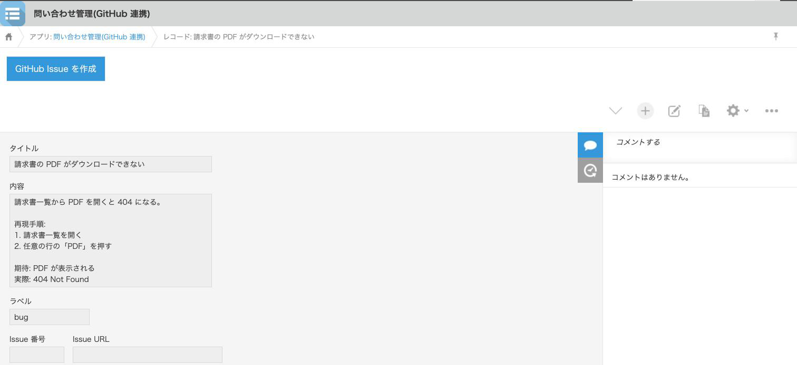
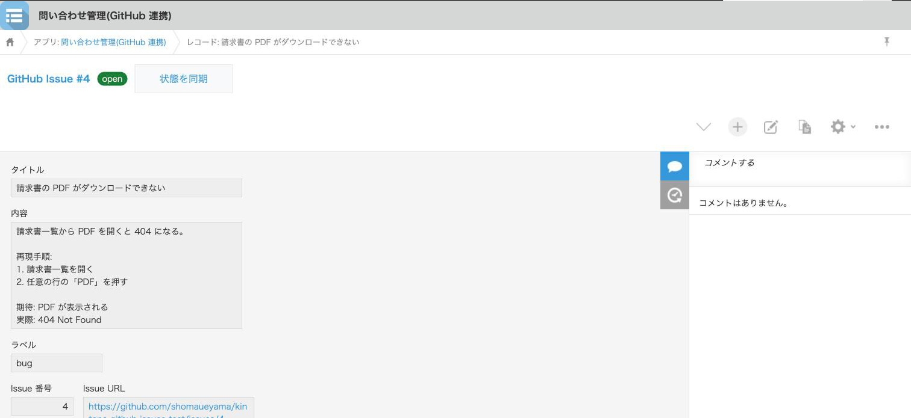
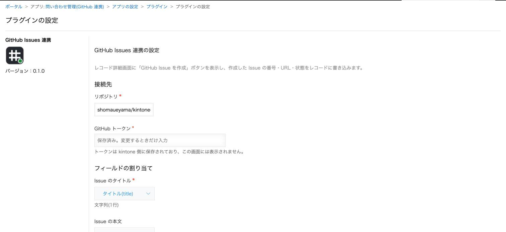
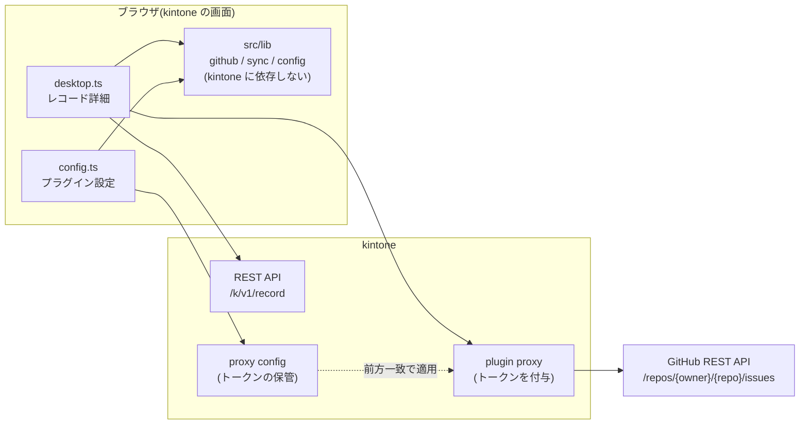

# kintone GitHub Issues 連携プラグイン

kintone のレコードから GitHub Issue を作成し、Issue の状態(open / closed)をレコードに同期する kintone プラグインです。
問い合わせ管理や不具合報告のアプリを kintone で運用し、対応は GitHub で行うチーム向けに作りました。

> **開発状況:** 設計・実装・単体テスト・パッケージングに加え、kintone 開発者環境での動作確認まで完了(2026-11-05)。確認した 14 項目のうち 12 項目が OK、トークンの再入力が要る 2 項目(無効トークン・誤ったリポジトリ名)は未確認。記録は [docs/verification.md](docs/verification.md)。

## できること

| 画面 | 動作 |
|---|---|
| レコード詳細(Issue 未作成) | 「GitHub Issue を作成」ボタン。レコードのタイトル・本文・ラベルから Issue を作り、番号・URL・状態をレコードに書き込む |
| レコード詳細(作成済み) | Issue へのリンクと状態バッジ。「状態を同期」で GitHub の状態を読み、変わっていればレコードを更新する |
| プラグイン設定 | リポジトリ、トークン、フィールドの割り当て。フィールドはアプリの定義から種類で絞ってドロップダウンで選ぶ |

やらないこと(意図して外した): レコード保存時の自動作成、GitHub 側からの逆同期、Issue 本文の双方向編集。理由は [ADR 0001](docs/adr/0001-manual-button-not-auto-create.md)。

## 画面

| 作成前 | 作成後 |
|---|---|
|  |  |

設定画面。フィールドはアプリの定義から種類で絞って選ぶ。トークンは保存後に画面へ戻らない。



## 構成



- 判断(リクエストの組み立て、応答の検証、エラーの分類、レコードとの対応づけ)は `src/lib` に集め、kintone のグローバルに依存しない形にしている。単体テストはこの層を対象にしている
- `src/desktop.ts` と `src/config.ts` は、画面と kintone API を `src/lib` につなぐだけ
- GitHub のトークンは `kintone.plugin.app.setProxyConfig` で kintone 側に保存し、プラグインの JavaScript からは読めない([ADR 0002](docs/adr/0002-token-in-proxy-config.md))

## 処理の流れ

**作成**

1. ボタン押下。レコードを取り直し、Issue 番号が空のままか確かめる(別タブで先に作成されていたら中止)
2. `POST /repos/{owner}/{repo}/issues`(proxy 経由。トークンは kintone が付与)
3. 応答から番号・URL・状態を取り出し、レコードを `PUT /k/v1/record`
4. 3 が失敗したら、Issue の URL を画面に残し「レコードへの書き込みを再試行」だけをやり直せるようにする([ADR 0003](docs/adr/0003-double-create-and-partial-failure.md))

**同期**

1. `GET /repos/{owner}/{repo}/issues/{number}`
2. 番号・URL・状態のどれかがレコードと違うときだけ `PUT`。同期日時だけの差では書かない(更新履歴を汚さない)

## セットアップ

1. GitHub で Fine-grained personal access token を作る。対象リポジトリのみ、権限は Issues: Read and write
2. kintone アプリに次のフィールドを用意する

   | 役割 | 種類 | 必須 |
   |---|---|---|
   | タイトル | 文字列(1行) | 必須 |
   | 本文 | 文字列(複数行) | 任意 |
   | ラベル | チェックボックス / 複数選択(選択肢名 = ラベル名) | 任意 |
   | Issue 番号 | 数値 | 必須 |
   | Issue URL | リンク | 任意 |
   | Issue 状態 | 文字列(1行) / ドロップダウン(open, closed) | 任意 |
   | 最終同期日時 | 日時 | 任意 |

3. `dist/plugin.zip` を kintone システム管理 → プラグイン から読み込み、アプリに追加する
4. プラグイン設定でリポジトリ・トークン・フィールドを設定し、アプリを更新する

トークンは一度保存すると画面には戻らない。リポジトリを変えるときだけ再入力を求める。

## 開発

```bash
npm install
npm test          # Vitest(src/lib の単体テスト)
npm run typecheck # tsc --noEmit
npm run lint      # @cybozu/eslint-config
npm run build:prod  # dist/plugin.zip を生成(private.ppk が必要)
```

- 雛形は [cli-kintone](https://github.com/kintone/cli-kintone) の `plugin init --template typescript`
- 設定画面と詳細画面の部品は [kintone UI Component](https://github.com/kintone/kintone-ui-component) v1
- `private.ppk` はプラグイン ID を決める秘密鍵。リポジトリには含めない(`.gitignore`)。CI では検証用に使い捨ての鍵を生成してパッケージングだけ確かめる
- `npm run upload` は `cli-kintone plugin upload` を呼ぶ。接続先は環境変数 `KINTONE_BASE_URL` / `KINTONE_USERNAME` / `KINTONE_PASSWORD` で渡す

## 設計判断の記録

- [ADR 0001: 自動作成ではなく明示的なボタンにする](docs/adr/0001-manual-button-not-auto-create.md)
- [ADR 0002: トークンは proxy 設定に保存し、プラグイン設定には入れない](docs/adr/0002-token-in-proxy-config.md)
- [ADR 0003: 二重作成の防止と、作成後にレコードへ書けなかったときの復旧](docs/adr/0003-double-create-and-partial-failure.md)
- [ADR 0004: 判断を kintone 非依存の層に寄せ、そこだけ単体テストする](docs/adr/0004-kintone-free-core.md)

コードを読む順番は [docs/reading-guide.md](docs/reading-guide.md) にまとめた。

## 制限

- 1つのプラグイン設定につき1リポジトリ。アプリごとにリポジトリを変えることはできる
- 状態の同期は詳細画面を開いて「同期」を押したときだけ。一覧での一括同期や定期同期はない
- GitHub のレート制限(認証ありで 5,000 回/時)は、この用途では通常届かないため制御していない。超えたときは 403 として利用者に知らせる

## 作者について

このプラグインは、サイボウズのエコシステムエンジニア職への応募にあたり、kintone のプラグイン開発と外部 SaaS 連携の設計を示すために作った。設計と実装は AI(Claude Code)を使って進め、要件・設計判断・レビュー・動作確認は作者が行っている。

## ライセンス

MIT
